# Git Hooks Lifecycle: A Deep Dive into Git Automation

Git is usually introduced as a version-control system: you modify files, stage changes, create commits, create branches, and push your work to a remote repository.

But Git has another powerful capability that is easy to overlook:

> **Git can automatically execute scripts at specific points in its lifecycle.**

These scripts are called **Git hooks**.

Git hooks let you attach automation to important Git events. They can validate code before a commit, enforce commit-message conventions, run checks before a push, enforce server-side repository policies, and trigger downstream automation after changes are accepted.

This article explains the Git hooks lifecycle from a developer's local machine all the way to a remote Git server.

---

## 1. What Is a Git Hook?

A Git hook is an **executable script that Git runs automatically when a particular event occurs**.

For example, when you run:

```bash
git commit -m "Add authentication"
```

Git can execute a `pre-commit` hook before creating the commit.

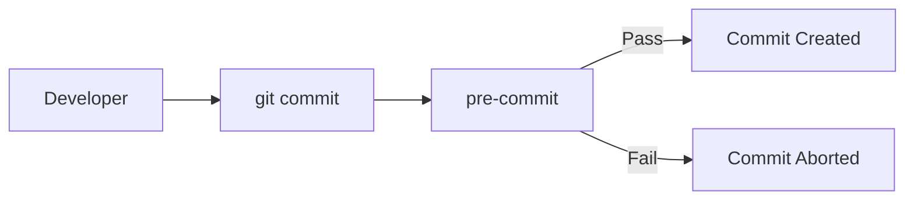

This gives Git a natural place to perform automated checks.

Typical uses include:

- Code formatting
- Linting
- Unit tests
- Commit-message validation
- Secret detection
- Security checks
- Branch-policy enforcement
- Notifications
- Deployment triggers

---

# 2. Why Do Git Hooks Exist?

Without hooks, developers need to remember a series of repetitive actions:

```text
Write code
    ↓
Format code
    ↓
Run linter
    ↓
Run tests
    ↓
Check commit message
    ↓
Commit
    ↓
Push
```

Humans inevitably forget steps.

Hooks allow us to automate the workflow:

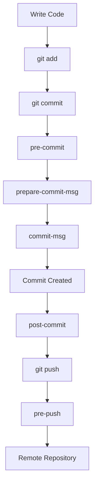

The result is a more consistent development process.

The core benefits are:

- **Consistency** — everyone gets the same automated checks.
- **Fast feedback** — problems can be detected before code leaves the developer's machine.
- **Automation** — repetitive tasks don't depend on human memory.
- **Quality enforcement** — teams can establish common standards.
- **Security** — hooks can detect suspicious files, secrets, or unsafe changes.
- **Developer productivity** — developers spend less time manually running routine checks.

---

# 3. Where Are Git Hooks Stored?

Git's default hook directory is:

```text
.git/hooks/
```

After running:

```bash
git init
```

you'll typically see something similar to:

```text
.git/
├── HEAD
├── config
├── objects/
├── refs/
└── hooks/
    ├── pre-commit.sample
    ├── commit-msg.sample
    ├── pre-push.sample
    ├── pre-rebase.sample
    └── ...
```

The `.sample` files are examples.

To create a real hook, you can create a file such as:

```text
.git/hooks/pre-commit
```

and make it executable:

```bash
chmod +x .git/hooks/pre-commit
```

A simple hook might look like:

```bash
#!/bin/sh

echo "Running pre-commit checks..."
npm test
```

When `git commit` reaches the `pre-commit` stage, Git executes this script.

---

# 4. The Big Picture: Git's Lifecycle

A useful mental model is to divide Git's workflow into four stages:

1. **Working directory**
2. **Staging area**
3. **Local repository**
4. **Remote repository**

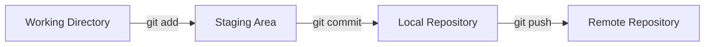

Hooks can intercept important events along this path.

A more complete lifecycle looks like this:

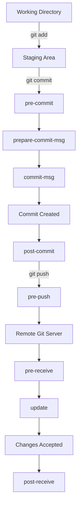

This diagram is the foundation for understanding Git hooks.

---

# 5. Client-Side vs Server-Side Hooks

Git hooks are broadly divided into two categories.

## Client-Side Hooks

These execute on the developer's local machine.

Examples:

- `pre-commit`
- `prepare-commit-msg`
- `commit-msg`
- `post-commit`
- `pre-rebase`
- `post-rewrite`
- `post-checkout`
- `post-merge`
- `pre-push`

Their primary purpose is:

> **Improve the developer workflow and provide fast feedback.**

---

## Server-Side Hooks

These execute on the Git server.

Examples:

- `pre-receive`
- `update`
- `post-receive`

Their primary purpose is:

> **Enforce repository policies and trigger server-side automation.**

This distinction is important because local hooks can generally be bypassed by the developer, while server-side controls can provide authoritative enforcement.

---

# 6. The Commit Lifecycle

The commit lifecycle is where you'll encounter several important Git hooks.

When you run:

```bash
git commit
```

the simplified flow is:

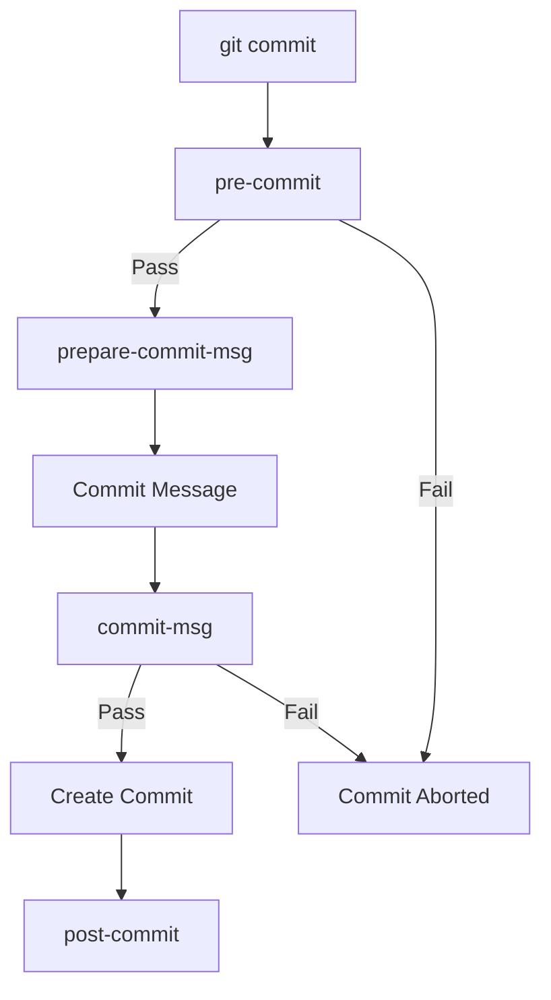

Let's examine each stage.

---

# 7. `pre-commit`

## When does it run?

`pre-commit` runs **before Git creates the commit**.

For example:

```bash
git add .
git commit -m "Add authentication"
```

The lifecycle is:

```text
git commit
    ↓
pre-commit
    ↓
Commit
```

If the hook exits with a non-zero status, Git can stop the commit.

## What is it used for?

This is probably the most commonly used Git hook.

Typical tasks include:

- Formatting
- Linting
- Static analysis
- Fast unit tests
- Secret detection
- Debug-statement detection
- Checking generated files

For example:

```bash
#!/bin/sh

echo "Running tests..."

npm test

if [ $? -ne 0 ]; then
    echo "Tests failed. Commit aborted."
    exit 1
fi
```

Now:

```bash
git commit
```

will only succeed if the test command succeeds.

## Best practice

Keep `pre-commit` checks relatively fast.

If every commit takes 10 minutes because the hook runs the entire integration-test suite, developers are likely to become frustrated and look for ways around it.

A good pattern is:

```text
pre-commit
    ↓
Formatting
    ↓
Linting
    ↓
Fast unit tests
```

and leave expensive checks to `pre-push` or CI.

---

# 8. `prepare-commit-msg`

`prepare-commit-msg` runs after Git has prepared the default commit message but **before the commit-message editor is opened**.

Its main purpose is to automatically prepare or modify the commit message.

For example, suppose your branch is:

```text
feature/JIRA-123-user-login
```

You could automatically prepare:

```text
[JIRA-123]
```

so the developer can complete it as:

```text
[JIRA-123] Add OAuth login
```

Conceptually:

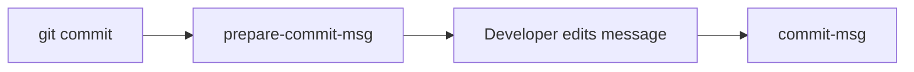

This hook is useful for:

- Adding issue IDs
- Adding branch metadata
- Applying project-specific commit prefixes
- Generating initial commit-message content

---

# 9. `commit-msg`

`commit-msg` runs **after the commit message has been entered but before the commit is created**.

That makes it ideal for validating commit messages.

Suppose your team uses Conventional Commits:

```text
feat: add login API
fix: resolve token expiration
docs: update authentication guide
refactor: simplify token service
test: add login tests
```

You may want to reject:

```text
changes
```

A simplified hook could look like:

```bash
#!/bin/sh

message=$(cat "$1")

if ! echo "$message" | grep -qE '^(feat|fix|docs|refactor|test|chore):'; then
    echo "Invalid commit message."
    echo "Expected: type: description"
    exit 1
fi
```

The lifecycle is:

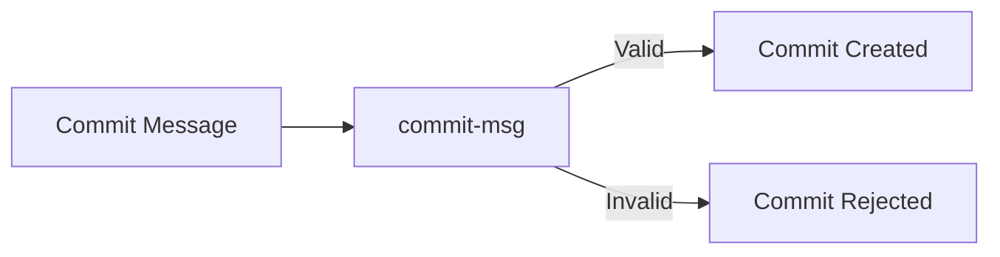

---

# 10. `post-commit`

`post-commit` runs **after the commit has successfully been created**.

Unlike `pre-commit`, it cannot prevent the commit because the commit already exists.

It can be useful for:

- Notifications
- Local logging
- Updating local metadata
- Triggering development tools

For example:

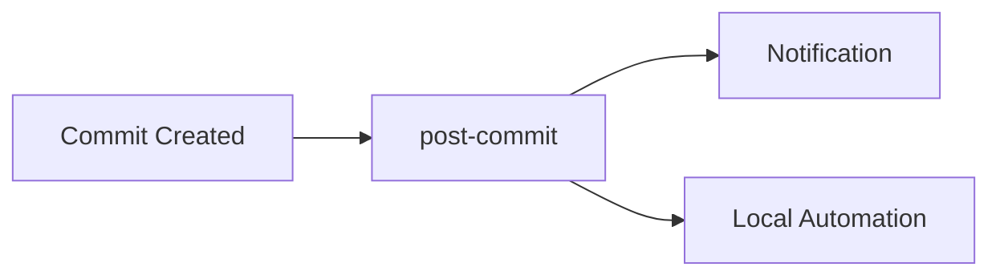

Avoid putting critical validation here because it's too late to reject the commit.

---

# 11. The Push Lifecycle

Once the developer has commits locally, they may run:

```bash
git push origin main
```

Before the changes reach the remote repository, the local `pre-push` hook can run.

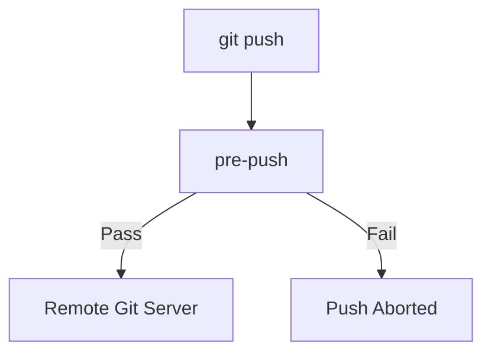

---

# 12. `pre-push`

`pre-push` runs **before Git sends the changes to the remote repository**.

This makes it a useful final checkpoint on the developer's machine.

You could use it to run:

```bash
npm test
```

or:

```bash
go test ./...
```

or:

```bash
pytest
```

A typical workflow could be:

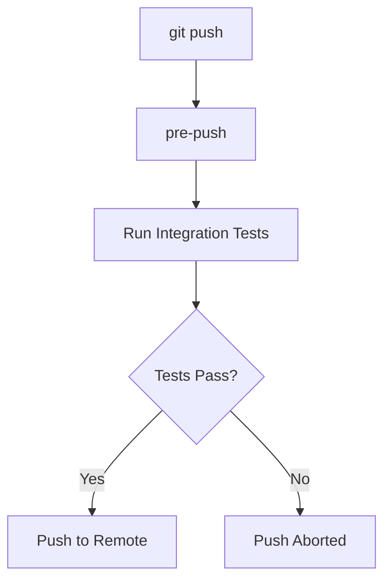

Compared with `pre-commit`, `pre-push` is often a better place for slower checks.

A useful strategy is:

```text
pre-commit
    ↓
Cheap and fast checks

pre-push
    ↓
More comprehensive checks

CI
    ↓
Complete authoritative validation
```

---

# 13. `pre-rebase`

`pre-rebase` runs before a rebase starts.

For example:

```bash
git rebase main
```

can trigger:

```text
pre-rebase
```

This can be used to prevent dangerous or inappropriate rebases.

For example, a team might decide that certain shared branches should not be rebased.

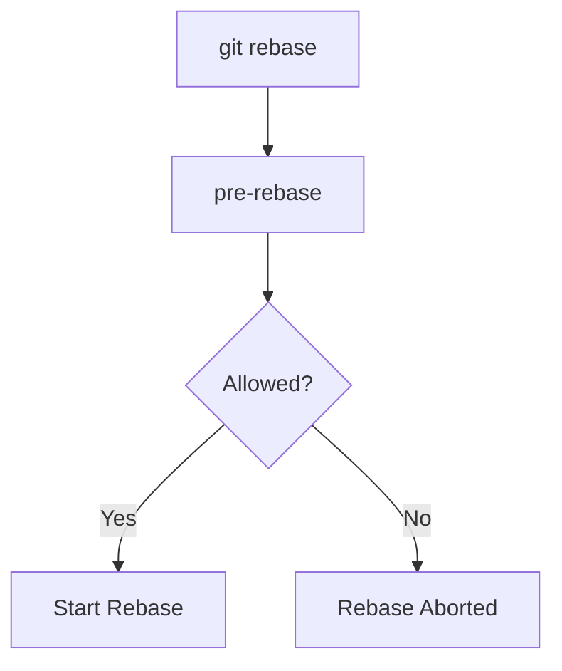

This is particularly useful in teams where rewriting shared history can cause problems.

---

# 14. `post-rewrite`

`post-rewrite` runs after commands that rewrite Git history, including operations such as:

```bash
git commit --amend
```

and:

```bash
git rebase
```

Why does this matter?

Because rewriting history changes commit IDs.

Before:

```text
A → B → C
```

After amending `C`:

```text
A → B → C'
```

`C'` is a different commit object.

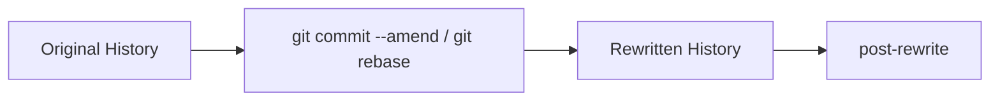

Tools that track commit relationships can use this hook to update their state.

---

# 15. `post-checkout`

`post-checkout` runs after:

```bash
git checkout
```

and is also relevant to branch switching workflows.

For example:

```bash
git switch feature/login
```

can result in:

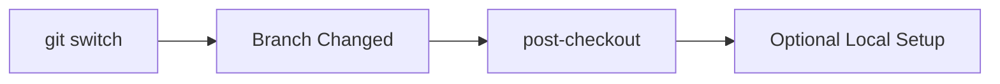

Potential uses include:

- Updating generated files
- Detecting environment changes
- Running local setup
- Updating dependencies

Use this carefully because automatic work after every branch switch can make branch changes surprisingly slow.

---

# 16. `post-merge`

`post-merge` runs after a successful merge.

For example:

```bash
git merge feature/login
```

can result in:

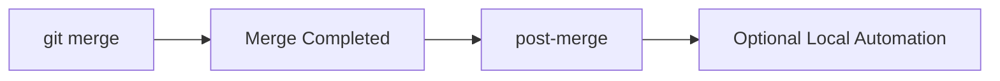

A common conceptual use is reacting to dependency-file changes.

For example:

```text
Merge
  ↓
package.json changed
  ↓
post-merge
  ↓
Update dependencies
```

---

# 17. Server-Side Hooks

Everything we've discussed so far has primarily happened on the developer's machine.

But Git also has server-side hooks.

The important ones are:

```text
pre-receive
update
post-receive
```

The high-level flow looks like this:

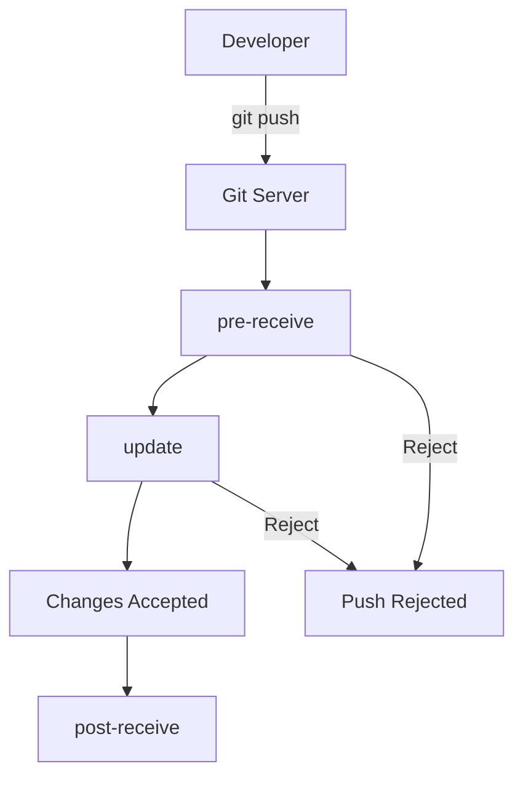

---

# 18. `pre-receive`

`pre-receive` executes on the server **before Git accepts the pushed changes**.

This makes it useful for repository-level policy enforcement.

Potential checks include:

- Protected branch policies
- Permission rules
- Commit validation
- Security policies
- Repository-specific restrictions

For example:

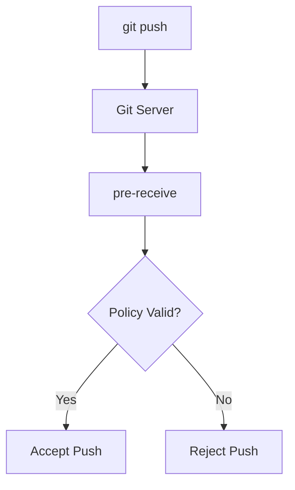

The key advantage is that the validation happens on the server.

---

# 19. `update`

`update` is another server-side hook.

A useful way to think about the distinction is:

- `pre-receive` evaluates the incoming push as a whole.
- `update` is invoked for each reference being updated.

For example, a push could update:

```text
refs/heads/main
refs/heads/develop
```

The server can apply different rules to different branches.

Conceptually:

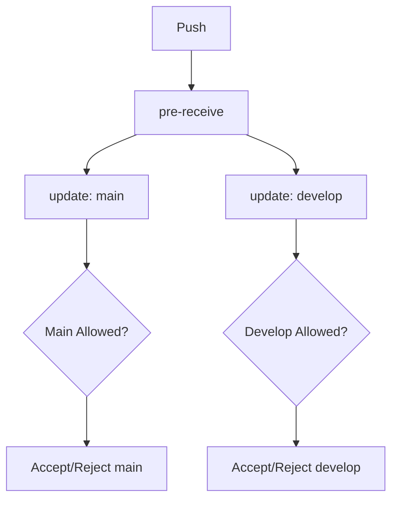

This makes `update` useful for branch- or reference-specific policies.

---

# 20. `post-receive`

`post-receive` runs **after the server has accepted the changes**.

This is where Git hooks can trigger downstream automation.

For example:

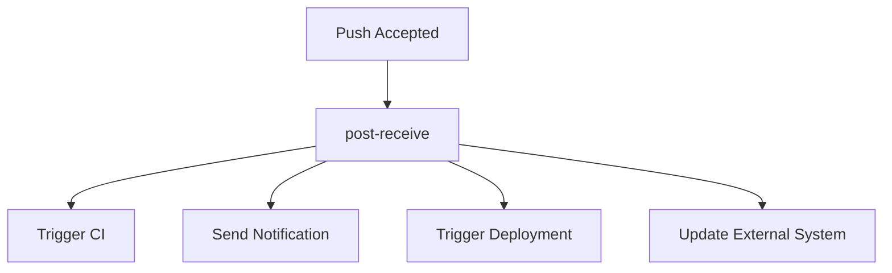

Historically, server-side hooks were commonly used to trigger deployments.

Modern platforms often provide dedicated CI/CD pipelines and webhooks, but understanding `post-receive` helps explain the underlying Git model.

---

# 21. The Complete Git Hooks Lifecycle

Now we can combine everything into one diagram.

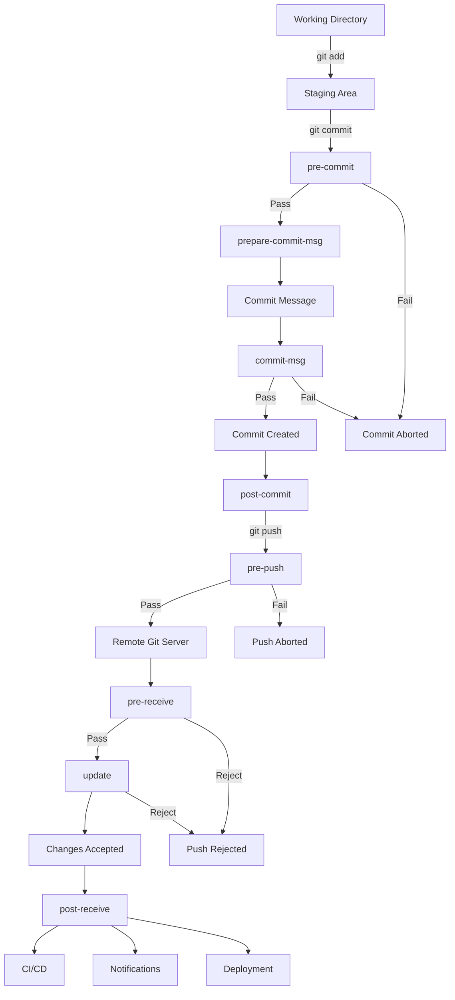

This is the most useful diagram to keep in mind when learning Git hooks.

---

# 22. Git Hooks vs CI/CD

A common question is:

> If we already have CI/CD, why do we need Git hooks?

Because they operate at different stages.

### Git hooks

Run close to the developer:

```text
Developer
    ↓
Git Hook
    ↓
Commit / Push
```

### CI/CD

Usually runs after code reaches the remote repository:

```text
Developer
    ↓
Push
    ↓
Remote Repository
    ↓
CI
    ↓
Build
    ↓
Tests
    ↓
Deploy
```

Consider a formatting error.

Without a local hook:

```text
git push
    ↓
CI starts
    ↓
Build
    ↓
Tests
    ↓
10 minutes later
    ↓
Formatting failed
```

With a local hook:

```text
git commit
    ↓
pre-commit
    ↓
Formatting failed
    ↓
Developer fixes it
```

The feedback loop is much shorter.

---

# 23. Why Git Hooks Should Not Be Your Only Enforcement Layer

There is an important limitation with client-side hooks.

A developer can bypass many local hooks using:

```bash
git commit --no-verify
```

or:

```bash
git push --no-verify
```

Therefore, critical policies should not rely solely on local hooks.

A stronger architecture is:

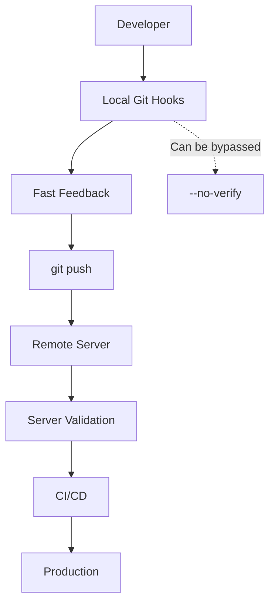

The principle is:

> **Use local hooks for developer experience; use CI/server-side controls for authoritative enforcement.**

---

# 24. A Practical Hook Strategy

A mature development workflow might distribute responsibilities like this:

| Stage | Hook | Typical Responsibility |
|---|---|---|
| Commit | `pre-commit` | Formatting, linting, fast tests |
| Commit | `prepare-commit-msg` | Add issue IDs or metadata |
| Commit | `commit-msg` | Validate commit format |
| After commit | `post-commit` | Notifications/local automation |
| Push | `pre-push` | Integration tests/security checks |
| Server | `pre-receive` | Repository-level policies |
| Server | `update` | Branch/ref-specific rules |
| Server | `post-receive` | Trigger downstream automation |

A good rule is:

> **Put cheap checks early and expensive checks later.**

For example:

```mermaid
flowchart LR
    A[Code Change] --> B[pre-commit]
    B --> C["Format + Lint + Fast Tests"]
    C --> D[Commit]
    D --> E[pre-push]
    E --> F["Integration Tests"]
    F --> G[Push]
    G --> H[CI/CD]
    H --> I["Full Validation + Deployment"]
```

---

# 25. Git Hooks in Modern Development

In modern projects, teams often use tools to manage hooks rather than maintaining raw shell scripts manually.

For example, JavaScript projects commonly use tools such as:

- **Husky**
- **lint-staged**
- **commitlint**

A typical workflow might be:

```mermaid
flowchart TD
    A["git commit"] --> B[Husky]
    B --> C[lint-staged]
    C --> D[ESLint]
    C --> E[Prettier]
    B --> F[commitlint]
    D --> G[Commit]
    E --> G
    F --> G
```

Python projects commonly use the **pre-commit** framework to manage multiple checks.

The abstraction doesn't change:

```text
Git Event
    ↓
Git Hook
    ↓
Hook Management Tool
    ↓
Validation / Automation
```

These tools simply make installation, configuration, and sharing hooks across a team easier.

---

# 26. Common Mistakes

## Mistake 1: Running expensive tests in `pre-commit`

If every commit takes several minutes, developers will dislike the workflow.

Prefer:

```text
pre-commit → fast checks
pre-push   → broader checks
CI         → complete validation
```

---

## Mistake 2: Relying only on client-side hooks

Client hooks can be bypassed.

For important rules:

```text
Local Hook
    +
CI / Server Validation
```

is much stronger.

---

## Mistake 3: Making hooks difficult to debug

A hook should clearly tell developers why it failed.

Bad:

```text
ERROR
```

Better:

```text
Commit rejected.

Reason:
ESLint found 3 errors.

Run:
npm run lint
```

A good hook should tell the developer:

1. What failed?
2. Why did it fail?
3. How can it be fixed?

---

## Mistake 4: Putting unrelated automation into hooks

Hooks execute as part of Git operations.

If they become responsible for too many unrelated tasks, Git commands can become unpredictable and slow.

Keep each hook focused on its lifecycle event.

---

# 27. The Five Hooks You Should Remember First

You don't need to memorize every Git hook immediately.

Start with these five:

### `pre-commit`

> **Before creating the commit, validate the code.**

```text
git commit
    ↓
pre-commit
    ↓
commit
```

### `prepare-commit-msg`

> **Prepare the commit message before the developer edits it.**

```text
branch
  ↓
prepare-commit-msg
  ↓
commit message
```

### `commit-msg`

> **Validate the commit message.**

```text
commit message
      ↓
 commit-msg
      ↓
   commit
```

### `pre-push`

> **Before sending changes to the remote, run final local checks.**

```text
git push
   ↓
pre-push
   ↓
remote
```

### `pre-receive`

> **Before the server accepts changes, enforce repository rules.**

```text
push
 ↓
server
 ↓
pre-receive
 ↓
accept / reject
```

Once these are clear, the rest of the hooks become much easier to understand.

---

# 28. A Simple Mental Model

If you remember only one concept from this article, remember this:

```mermaid
flowchart TD
    A[Developer Action] --> B{Git Lifecycle Event}
    B --> C[Before Event]
    C --> D[Git Performs Event]
    D --> E[After Event]

    C -.-> F["pre-* hooks"]
    E -.-> G["post-* hooks"]
```

Git hooks are essentially **extension points in Git's lifecycle**.

The naming convention itself gives you a useful clue:

- `pre-*` → execute **before** something happens
- `post-*` → execute **after** something happens
- `*-msg` → work with commit messages
- `*-receive` → server-side handling of incoming pushes

---

# 29. Final Takeaway

Git hooks are more than scripts that run before `git commit`.

They form an automation layer around the Git lifecycle:

```mermaid
flowchart TD
    A[Developer] --> B[Working Directory]
    B --> C[Staging]
    C --> D[Commit]
    D --> E[Local Validation]
    E --> F[Push]
    F --> G[Server Validation]
    G --> H[CI/CD]
    H --> I[Deployment]
```

The most important architectural idea is:

> **Use hooks to put the right automation at the right point in the software-delivery lifecycle.**

A practical setup often looks like:

```text
pre-commit
    ↓
Fast feedback
    ↓
commit-msg
    ↓
Consistent history
    ↓
pre-push
    ↓
Broader local validation
    ↓
Server / CI
    ↓
Authoritative validation
    ↓
Deployment
```

Once you understand this lifecycle, Git hooks become much easier to reason about—not as a collection of unrelated scripts, but as **event-driven automation points inside Git's workflow**.
